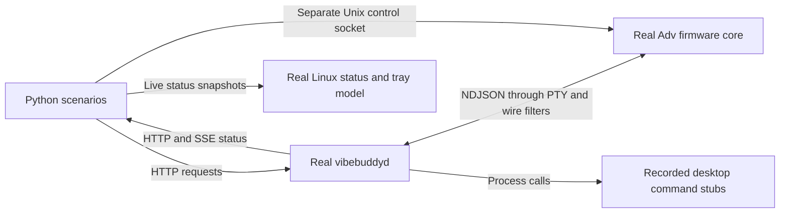

# Linux host tests with a simulated Cardputer-ADV

This began as the first implementation wave, before G4's Linux parity changes. Those changes (P0, P1 and P3) now run
here too, each with its own scenarios; the validation sections record each checkpoint. It exercises the computer-side code without a physical device: the real daemon, the firmware core compiled for Cardputer-ADV, and the Linux app's
status decoder and tray model. P2 has not started.

## Device and protocol evidence

Reviewed on 2026-10-17:

| Evidence | Consequence for the tests |
|---|---|
| [M5Stack product documentation](https://docs.m5stack.com/en/core/Cardputer-Adv): ESP32-S3FN8, 8 MB flash, ST7789V2 240×135 panel, ES8311 audio codec, G0 download button | Build with `board-cardputer-adv`, allocate 8 MB of simulated flash and use the compact framebuffer. |
| M5Stack's [factory keyboard driver](https://github.com/m5stack/M5Cardputer-UserDemo/blob/CardputerADV/main/hal/keyboard/keyboard.cpp) and [HAL constants](https://github.com/m5stack/M5Cardputer-UserDemo/blob/CardputerADV/main/hal/hal_config.h): TCA8418, 7×8 matrix, interrupt G11 | Inject logical key levels at the `Board` boundary; key scanning is covered by existing keymap tests and hardware acceptance. |
| [Local device measurements](references/cardputer-adv/device-specs.md): native USB `303a:1001`, no PSRAM, low free internal RAM; VibeBuddy's K0=G0, K1=`;`, K2=`.` | Prioritize the USB path. No claim that a host simulator establishes network viability or reproduces the hardware heap. |
| [Panel calibration](references/cardputer-adv/display-calibration.md): 240×135 frame, offsets 40/53 confirmed on one unit | Test screenshots at 240×135; panel alignment itself requires the device. |
| [VibeBuddy protocol](protocol.md), `firmware-rs/core/src/firmware.rs`, `buttons.rs`, `daemon/src/serial_transport.rs` and `status.rs` | These define the wire signals and computer responses. M5Stack's factory firmware does not implement the VibeBuddy protocol. |
| `firmware/partitions-cardputer-adv.csv` | Load the simulator's partition table from the production CSV: two 3 MB app slots, 1.75 MB voices, moved OTA/link regions. |

The vendor product page, library README and two factory source files were re-read through the browsing fallback.
The Chromium/CDP reader was unavailable; the previously recorded `/en/products/sku/K132-ADV` URL also failed, while
`/en/core/Cardputer-Adv` worked. Hardware observations above remain the repository's recorded measurements; no new
physical-device probes were performed.

## Run

On Linux, with Python 3.10+, the workspace Rust toolchain, `pkg-config`, `libudev` development files and OpenSSL
development files (used by the simulator's existing Relay example dependency):

```sh
bash tools/test-linux-host.sh
```

The first build needs Cargo registry access. The tests themselves use only local processes, Unix sockets, PTYs and
loopback HTTP. No Python packages, logged-in desktop, root access, serial-group membership or attached box are needed.
An execution sandbox must permit those local sockets and PTYs.

Use unittest's name filter for a subset:

```sh
bash tools/test-linux-host.sh -k k2
```

The runner builds the daemon and headless Linux app probe in `target/`, and the firmware simulator separately in
`target/cardputer-adv/`. This avoids unifying the mutually exclusive BOX and Adv board features through the daemon's
dev-dependency. Run the Adv firmware-core tests separately too:

```sh
cargo test --locked -p vibebuddy-firmware-core --no-default-features \
  --features board-cardputer-adv --target-dir target/cardputer-adv
```

Ordinary `python3 -m unittest discover -s tools -p 'test_*.py'` skips the host integration suite; the dedicated runner
sets `VIBEBUDDY_HOST_TESTS=1`. CI runs both the dedicated suite and Adv firmware-core tests.
CI uploads `target/host-tests` as a diagnostic artifact on failure, retained for seven days.

## Harness boundaries



`tools/host_test_support.py` owns the processes and PTY. Each scenario uses a new temporary config/state tree,
pairing identity and available loopback port. `VIBEBUDDY_SERIAL_PORT` points only to its PTY symlink. The daemon's
environment omits `HOME`, agent hooks and desktop bus variables; explicit XDG directories keep its files isolated.
Update checks and Relay use are disabled, with loopback-only fallback URLs, and CI repository polling is empty.

`hyprctl`, `swaymsg`, `wmctrl`, `xdg-open`, `notify-send`, `systemctl` and `gh` resolve to per-test stubs. Their argument
lists are recorded; responses, exit codes and a `sleep` before answering can be configured with `command_reply`. One
reply per program applies to every argument list. The Hyprland tests exercise its older dispatch syntax and command
failure/recovery. The `systemctl` and `notify-send` stubs carry the G4 P0 outage scenarios. The `swaymsg` and `wmctrl`
stubs carry the P1 scenarios. Their replies can be keyed by leading arguments (`command_reply(name, args=[...], ...)`),
so the window listing and the focus call can differ, and stderr can be set. The window listings are synthetic
(`tools/fixtures/linux-windows/README.md`).

The PTY has no USB VID/PID metadata. The existing explicit-port path therefore assumes bridge pacing and reports
`device.bridge=true`, even though the physical Adv uses native USB. USB discovery, native-USB write timing, DTR reset,
udev permissions and actual re-enumeration still need hardware tests. Replug tests replace the PTY behind a stable
symlink. The harness clears `TIOCEXCL` after stopping its daemon because it retains a slave handle between processes.

## Signal and response coverage

Firmware-generated signals go through real parsing, aggregation, serial transport and HTTP/SSE publication. Cases
marked synthetic deliberately inject or replace output to exercise device-layer callbacks or broken peers.

| Stimulus / signal | Computer-side response checked |
|---|---|
| Boot build/version, voice, volume, `LINK NOISE`, `BOX KEY`, `PAIRED`, pair list | Firmware recognized; identity and settings reach status; automatic pairing completes. |
| Explicit synthetic `BOARD cardputer-adv` | Host records the unsupported board. Current device firmware does not emit this line; the simulator does not invent it. |
| Identify; volume set/preview; invalid volume; unsolicited `VOLUME`; `VOLUME ERROR` | Correct command/reply, range validation and device-owned volume in status. |
| Working, needs input, failed, done events | HTTP events reach the firmware's display and announcement paths. |
| K2 short press on release | Source focus command; needs-input priority; completed source retained; destination survives daemon restart. |
| Nearest ancestor window; Lua dispatch rejected; desktop command fails | Correct PID choice, legacy Hyprland fallback and recovery on the next press. |
| K2 on Sway: nearest ancestor's container focused with `swaymsg`; needs-input priority; completed source survives a restart; refused focus, failing or slow `swaymsg`, missing window, malformed tree; a stale `SWAYSOCK` falls back to Hyprland | `SwayFocusTests`. `swaymsg -t get_tree` and `[con_id=N] focus` are answered by a synthetic tree and reply. A refused focus is logged with its reply and the next press recovers; failures and timeouts are logged, and nothing else is focused. |
| K2 on X11: nearest ancestor raised with `wmctrl -i -a`; missing, malformed or invalid listing rows; refused raise; failing or slow `wmctrl`; an Xwayland session stays on Hyprland | `X11FocusTests`. `wmctrl -l -p` is answered by a synthetic listing. Invalid rows are skipped, and errors are logged with their stderr. Missing executables and the selection rules are covered by unit tests in `daemon/src/window_focus.rs`. |
| K0/K1 taps, K2 hold, K1 hold and menu K2 | Pomodoro/mode diagnostics reach status; mute/menu actions stay local and do not open a source. |
| Firmware clock advanced across a focus period | Focus completion diagnostic without waiting 25 minutes. |
| Disconnect, new PTY, device reset | Offline/reconnect status; settings and pairing key restored from the same simulated flash. |
| Second computer paired then unpaired; self-unpair request | Pair list changes; host refuses to remove its own pairing. |
| Wi-Fi set/scan/forget commands; synthetic scan/failure/join/address/disconnect lines | Commands reach firmware; host deduplicates/sorts scan results and clears failure/address state appropriately. No radio is simulated. |
| Legacy voice pack and current Character pack | Stop-and-wait receipts, completed operation, saved Character selection and device storage. |
| Corrupted pack payload; pack exceeds Adv partition | Device refusal becomes failed operation; rejected data does not change the saved selection. |
| Dropped/delayed/duplicate receipt, wrong sequence, injected `voice.error`, lost link | No next chunk before its receipt; delayed receipt resumes the write; one operation at a time; failure propagated; missing receipt times out and permits retry. |
| HTTP/SSE device updates; snapshots consumed by Linux app probe | Live status changes; real app decoder and online/offline/daemon-down tray model. |
| Split/coalesced CRLF lines, malformed JSON/version, oversized diagnostic | Recovery to valid status without launching a source. |
| Real Adv screenshot; synthetic valid BOX frame and malformed run | Adv limitation recorded; existing PNG path works on its supported dimensions; malformed pixels become HTTP errors. |
| Factory log line followed by several heartbeat intervals, then ROM reset/build | No hello or heartbeat is written to foreign firmware; normal traffic resumes after our build appears. |
| Daemon stopped (status stream retries every 2 s), with the unit `inactive`, `failed`, unreadable, slow or never read, and the app's notify toggle on, off or never read | `daemon_outage_probe` runs the app's real status stream through the outage policy and its `systemctl`/`notify-send` adapters. One `notify-send` per outage after a 4 s grace (shortened for the probe; the 30 s boundary is unit-tested with explicit instants); none for a brief restart, a stopped unit or a disabled toggle; rearmed after recovery. |

`tools/fixtures/cardputer-adv/boot.txt` replays the boot captured in `device-specs.md`, with the redacted box key replaced
by a synthetic key. `wifi.json` contains synthetic device-layer reports, using test-only network names and a
documentation-range IP address. Other scenarios generate actions directly or run the actual firmware core.

## Known gaps exposed before G4

1. **Adv screenshots fail on the computer.** `daemon/src/screenshot.rs` assumes 320×240, while the simulator produces
   a complete 240×135 frame. One passing characterization test asserts the existing 502 response and 32,400-pixel
   error. A separate expected-failure test specifies the desired 240×135 PNG; remove the marker with the later fix.
   Setup errors remain ordinary test failures. The characterization test prevents unrelated screenshot errors from
   being silently accepted by the expected-failure marker.
2. **Adv board identity is not reported.** The current Rust device/core boot does not print `BOARD cardputer-adv`.
   The host therefore cannot identify it using its existing board guard. An explicit synthetic report verifies the
   host path, without changing the real boot behavior or claiming firmware update offers are safe for the Adv.

Production daemon, hook and app behavior is unchanged by this infrastructure pass. The changes to the firmware
example provide simulator controls and a board-correct flash layout; they are not linked into device firmware.

## Diagnostics and extension

Artifacts remain under `target/host-tests/<scenario>-<unique suffix>/`: daemon/simulator logs, `wire.jsonl` with
host/device/delivered bytes, desktop command invocations, and the isolated config/state files. Override the parent
with `VIBEBUDDY_TEST_ARTIFACTS`. Process cleanup runs even if setup fails. Keep the failure directory when reporting
a regression; it contains synthetic test data and test identities.

For a new case, create a `HostHarness`, register `close` before `start`, then use:

- `control("buttons", k2=True)`, `control("advance", ms=80)` and `control("buttons")` for levels, or `press("K2")`.
- `control("reboot")` to keep simulated flash while reinitializing firmware.
- `emit(...)` for raw broken or device-layer reports; `filter(drop=..., replace=..., fragment=...)` for wire faults.
- `request`, `wait_device`, `wait_operation`, `wait_line` and `commands` for observable results and bounded waits.

The clock control advances **firmware** time only. Host receipt deadlines, reconnect delays and notification grace
periods still use real time. Existing Rust unit tests cover fast host timing rules; do not claim that advancing the
firmware clock validates G4 P0's future daemon-failure timer.

For manual serial-tool development:

```sh
python3 tools/simulate-device.py --board cardputer-adv --control /tmp/vb-control.sock
```

It prints its PTY path. A separate process can send one NDJSON command per Unix-socket connection; the reply is
`{"ok":true,"now_ms":...}` after the command has been applied and firmware polled. The socket is test-only and is
never part of the device protocol or daemon API. Omit `--board` for the existing BOX profile; `--tcp` and `--relay`
remain available for separate network development.

## Acceptance still required

The suite does not launch the iced window, exercise the real tray host/desktop notification server or focus an
actual window. It does not establish Claude/Codex Linux app availability or session URL handling (G4 P2). The Sway and
X11 focus backends (P1) are checked against synthetic window listings, not a real compositor or X server: that desktop
acceptance is pending. The daemon-failure notification (P0) is tested headless through the app's stream and the stubs, but
not on a real notification server or a real systemd unit: that desktop acceptance is pending. Hardware key scanning, sound, native USB
discovery/timing, RAM pressure, LAN/Relay handover and ROM flashing are separate acceptance tasks. Existing firmware
and daemon unit tests continue covering network/Noise/OTA logic; this first wave adds the missing USB host boundary.

## Validation recorded on 2026-10-17

All 30 current host scenarios were exercised: 29 passed and the desired Adv PNG test failed as expected. The
documented runner passed its 29-case run; the subsequently added delayed/duplicate receipt case passed separately.
The workspace tests, all 148 Adv firmware-core tests, existing Python tool tests and localization check passed.
Workspace Clippy and the Adv simulator's Clippy check completed with existing warnings. The default BOX simulator
also booted and produced a complete 320×240 screenshot. No physical device or graphical desktop was used.

## Validation recorded for G4 P0 on 2026-10-17

On top of `0c1360a`, with the P0 changes uncommitted: the full host runner passed 39 scenarios (30 existing and 9 new
`DaemonOutageTests`), with the same one expected screenshot failure, in 155 s. The new outage scenarios alone passed in
62 s. The workspace tests passed 502 cases (one ignored, the native-USB ROM test), up from 489 with the 13 new
desktop unit tests for the outage policy. The Adv firmware-core tests passed 101 and 47 cases. Workspace clippy
exits 0 with the four warnings that were already there, none in the desktop crate. The localization check passed with
285 keys. As a mutation check, a copy of the policy that stopped suppressing `inactive` and one that ignored the
toggle each failed exactly their matching scenario, and the policy was restored. Not run: a real desktop notification,
a real systemd unit, or the Mac app.

## Validation recorded for G4 P1 on 2026-10-17

On top of the P0 changes, still uncommitted: the full host runner passed 55 scenarios, with the same one expected
screenshot failure, in 204 s. That is the 30 existing scenarios, the 9 P0 outage scenarios, 9 Sway scenarios and 7 X11
scenarios. The Hyprland K2 scenarios, including the nearest-ancestor, legacy-dispatch and recovery cases, are among the
existing ones and passed unchanged. The workspace tests passed 522 cases, one ignored, up from 502 with 20 window-focus
unit tests. Clippy exits 0 with the same four warnings as before, none in the new code. The localization check passed.
Mutation checks: a Sway socket treated as live without checking it, and a refused focus counted as success, each failed
the scenarios that should catch them; an `x11` session routed to Hyprland failed all X11 scenarios except the Xwayland
guard, which is meant to pass. Not run: a real Sway or X11 session, a real `swaymsg` or `wmctrl`, and the systemd
environment of a real daemon. The window listings are synthetic.
